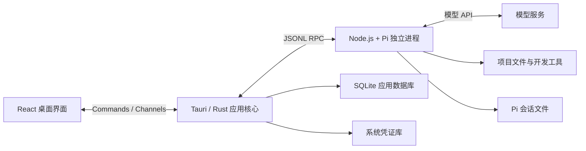

# Pi Hearth 整体架构

Pi Hearth 采用本地桌面架构：React 负责交互，Rust 管理应用服务，独立 Pi 进程执行代理任务。项目文件、会话和设置保存在本机，模型服务根据用户配置访问。

以下为目标架构与实施规划，具体技术选型见[技术栈](tech-stack.md)。

## 分层与数据流



| 模块 | 职责 |
| --- | --- |
| React 界面 | 项目与会话列表、对话、工具展示、设置和文件差异 |
| Tauri 命令层 | 暴露有类型的应用接口，校验请求与项目范围 |
| 会话与运行管理 | 会话绑定、任务状态、并发限制、订阅和恢复 |
| Pi 适配层 | 命令关联、事件转换、扩展交互和协议版本适配 |
| 进程管理 | 启动与释放 Pi、持续读取管道、停止任务和清理子进程 |
| 文件与 Git 服务 | 文件树、只读预览、Git 状态和差异查询 |
| 存储与凭证服务 | SQLite、迁移、凭证库和日志 |
| Pi | 模型请求、上下文管理、工具调用、重试、压缩和会话历史 |

前端调用应用级接口，Pi 的原始协议集中在 Rust 适配层处理。组件通过统一事件和状态读取任务进度。

## 通信与事件

React 通过 Commands 发出操作请求，Rust 通过 Channels 发送消息增量、工具输出与任务状态；普通事件用于低频通知。Channels 适合有序流式传输。参见 [Tauri 通信文档](https://v2.tauri.app/develop/calling-frontend/)。

Rust 通过 Pi 的 stdin / stdout JSONL RPC 通信，每条命令使用独立请求 ID 关联响应。持续消费 stdout 协议记录和 stderr 诊断输出，处理分段读取、UTF-8、背压、超时和异常退出。参见 [Pi RPC](https://github.com/earendil-works/pi/blob/main/packages/coding-agent/docs/rpc.md)。

当前通过本机 Node.js 启动项目固定依赖 `@earendil-works/pi-coding-agent` 的 `dist/bundle/cli.js`，以 RPC 模式运行。该文件是 Pi 包提供的进程入口；应用不查找全局 `pi` 命令，也不要求用户全局安装 Pi。版本查询接口 `pi_runtime_version` 读取实际运行入口所属包的版本。

应用事件带有项目、会话、运行标识及递增序号。每次运行还绑定进程实例，避免旧进程迟到的事件混入新任务。订阅在发送消息前建立，界面重新连接时先恢复状态快照，再接收后续增量。

命令被接受与任务完成分别处理：依据 `prompt` 返回的处理方式判断是否启动运行；已被扩展直接处理的输入无需等待运行事件。自动处理结束以 `agent_settled` 为依据，结束状态再结合错误与取消结果确定。参见 [Pi 运行生命周期](https://github.com/earendil-works/pi/blob/main/packages/coding-agent/docs/rpc.md#run-lifecycle)。

前端合并同一帧内的流式增量，通过虚拟列表展示长对话。工具输出采用有限缓存、折叠和按需读取，避免大输出持续占用内存或阻塞管道；状态与结束事件完整处理。

## 项目与会话

| 对象 | 含义 |
| --- | --- |
| 项目 | 用户添加的已有文件夹或新建文件夹，以及目录内的项目指令 |
| 会话 | 一段 Pi 对话，可独立存在，也可属于项目；关联 Pi 原生会话标识与文件位置 |
| 运行 | 一次用户任务及其自动工具循环，记录起止时间、状态和取消结果 |

Pi 进程按需启动，一个驻留进程绑定一个会话。同一会话同时执行一个任务；历史会话无需全部保留进程，空闲进程可释放，恢复时由 Pi 读取原会话文件。

打开客户端自动准备普通对话，或恢复上次项目和会话，不要求先选择项目或手动连接 Pi。每个项目可包含任意数量的会话，项目指令使用目录内的 `AGENTS.md`，已有 `CLAUDE.md` 时保留其兼容性。桌面端沿用 Pi 的项目指令与原生会话格式；列表同步所有已发现的 Pi 会话，并保留早期桌面专属目录中的历史。

首版对同一工作目录中的修改任务串行执行，不同项目允许受限并发。并发控制按实际工作目录识别，避免同一路径以不同项目记录打开后绕过限制。一个会话文件同时只有一个进程写入。

切换会话只切换展示与订阅，运行管理留在 Rust 核心中，后台任务继续执行。应用异常退出后，将未结束的运行标记为中断；重新打开时恢复历史与状态，由用户决定是否继续任务。

任务状态覆盖启动、运行、等待用户输入、停止，以及完成、取消、失败、中断。会话空闲状态与运行的最终结果分别保存。

## 停止与进程回收

停止操作按以下顺序完成：

1. 将运行标记为停止中，阻止本次运行继续加入新输入。
2. 先调用 `clear_queue` 清空待处理输入，再调用 `abort`，等待 Pi 回到空闲状态。
3. 如果存在通过独立 RPC `bash` 命令启动的执行，使用 `abort_bash` 单独终止。
4. 超时后升级为终止受管理的进程树，并记录中断原因；只有确认停止后才结束停止状态。

清队列后再中止，防止排队的消息继续触发执行。相关接口见 [Pi RPC 命令](https://github.com/earendil-works/pi/blob/main/packages/coding-agent/docs/rpc-commands.md)。

Windows 使用 Job Object 管理应用创建的进程树，其他平台采用对应进程组机制。应用退出时先请求正常关闭，再执行超时回收；清理范围限定为应用管理的进程。后台任务仅在桌面应用仍运行时继续，首版无需系统常驻服务。

## 数据归属

| 数据 | 权威存储 | 处理方式 |
| --- | --- | --- |
| 完整消息、工具结果和上下文历史 | Pi 会话文件 | 通过 Pi 保存与恢复，SQLite 索引可重建 |
| 项目、最近使用、会话索引、运行摘要和普通设置 | SQLite | SQLx 访问，使用版本化迁移 |
| API Key | 系统凭证库 | 由 Rust 读取并按需注入 Pi 进程环境 |
| 当前会话、面板、渲染缓存 | 前端状态 | 可从应用服务与会话历史重新构建 |
| 诊断信息 | 应用日志目录 | 脱敏、限制体积并轮转 |
| 文件内容与 Git 变更 | 用户工作目录与 Git 仓库 | 以磁盘和 Git 当前状态为准 |

Pi 会话以 Pi 运行时的存储规则为准，遵循默认目录、环境变量和项目的会话目录配置。源配置目录来自 `PI_CODING_AGENT_DIR` 或默认的 `~/.pi/agent`，并不依赖全局命令是否安装。桌面端的运行时配置与工具缓存保留在应用数据目录；使用独立 `PI_CODING_AGENT_DIR` 保护凭证传递时，通过明确的会话路径共享原生历史，升级时保留用户数据。

API Key 不写入 SQLite、前端持久化、命令行参数或日志。首版只接入 API Key；OAuth 与订阅登录在补齐凭证刷新、撤销和迁移方案后接入。

## 模型与扩展

模型配置支持提供商、API Key、兼容接口地址和模型选择，模型能力及用量展示以 Pi 元数据和返回值为准。模型请求由 Pi 统一处理，前端通过应用接口配置和查询。

首次打开项目时处理项目可信状态。工具审批通过随应用分发的可信 Pi 扩展在 `tool_call` 阶段执行，需要用户确认时转为桌面交互；超时、拒绝或审批通道失效时阻止对应工具调用。参见 [Pi 扩展接口](https://github.com/earendil-works/pi/blob/main/packages/coding-agent/docs/extensions.md)。

选择、确认和输入等扩展交互映射为桌面组件，通过原请求 ID 回应。TUI 专用自定义渲染需要单独适配。参见 [Pi RPC 扩展交互](https://github.com/earendil-works/pi/blob/main/packages/coding-agent/docs/rpc-extension-ui.md)。

Tauri capabilities 限制界面对桌面 API 的访问；Pi 仍以本机用户权限运行，工具审批与操作系统级沙箱是不同边界。扩展、技能与 MCP 复用 Pi 的能力，完整管理界面放在后续阶段。

## 工作台界面

采用左侧项目与会话、中间对话、右侧按需查看文件的三栏布局，右侧面板默认收起。尺寸、交互和视觉规范见[界面布局](ui-layout.md)。

| 区域 | 首版内容 |
| --- | --- |
| 左侧导航 | 项目、历史会话、当前运行状态 |
| 中间对话区 | 消息、流式回答、工具执行、输入框、停止与审批 |
| 右侧可折叠面板 | 文件树、只读文件预览和 Git 差异 |
| 设置 | 模型、凭证、运行时诊断和应用偏好 |

Git 面板展示工作目录实际差异。精确归属到某次任务的变更、检查点和自动回滚需要额外的基线快照机制，留待后续实现。

## 打包与更新

以下为发行目标；当前开发阶段使用本机 Node.js 和项目依赖中的 Pi，独立运行时打包尚未接入。

- 将匹配平台的 Node.js 作为 sidecar 分发，Pi 和随附扩展作为运行资源打包，统一由 Rust 启动。
- 启动时检查运行时资源、工作目录、Shell 和 Git 等依赖；支持中文与含空格路径。
- Windows 首轮验证后，再分别完成 macOS 与 Linux 的构建、依赖检查和实机测试。
- 使用 Tauri Updater 校验签名更新包，待任务结束后安装更新。更新包签名与操作系统代码签名分别处理。

打包与更新机制参见 [Tauri sidecar](https://v2.tauri.app/develop/sidecar/)和[Updater](https://v2.tauri.app/plugin/updater/)。

## 目录规划

采用单应用仓库，按功能组织前端，按职责组织 Rust 服务。以下为目标目录，随功能接入逐步补齐。

```text
pi-hearth/
  README.md
  docs/                  技术栈、架构与界面布局
  src/                   React 界面
    app/                 应用入口与工作台布局
    features/            项目、会话、对话、设置和差异
    components/          共用界面组件
    lib/                 Tauri 调用、生成类型和通用逻辑
  src-tauri/             Rust 桌面核心
    src/                 命令、会话、Pi 适配、进程和存储
    capabilities/        桌面 API 权限
    resources/           Pi 与随附扩展资源
    binaries/            平台 sidecar
  tests/                 桌面端集成测试
```

## 实施阶段

| 阶段 | 工作内容 | 完成标准 |
| --- | --- | --- |
| 核心链路验证 | 打包运行时、启动 Pi、模型鉴权、流式通信、停止与会话恢复 | 在目标机器跑通真实任务，验证路径、资源位置和大输出 |
| 基础工作台 | 项目、模型设置、会话、对话、工具展示和审批 | 能完成一次任务、停止任务并恢复历史会话 |
| 项目查看能力 | 文件树、只读预览、Git 差异和运行诊断 | 能核对文件变化，并定位启动与执行失败 |
| 桌面发布 | 安装包、更新、凭证库、进程回收和端到端验证 | 安装后无需额外安装 Node.js，升级保留数据，退出能回收受管理进程 |

后续再评估完整编辑、交互式终端、Git worktree、任务检查点与回滚、扩展管理界面、OAuth 和多代理编排；手机端不在产品范围内。

## 首版验收重点

- 多会话切换不会串消息，后台任务状态与实际执行一致。
- 停止后队列和执行均结束，正常退出或异常恢复能处理受管理进程。
- 恢复会话保留完整历史，不自动重跑中断任务。
- 长对话、大工具输出和中文路径下保持可用。
- 文件与差异展示反映磁盘真实状态，密钥不进入应用数据库和日志。
- 安装与升级验证覆盖打包后的真实运行时，前端与核心服务测试覆盖关键状态和失败路径。
